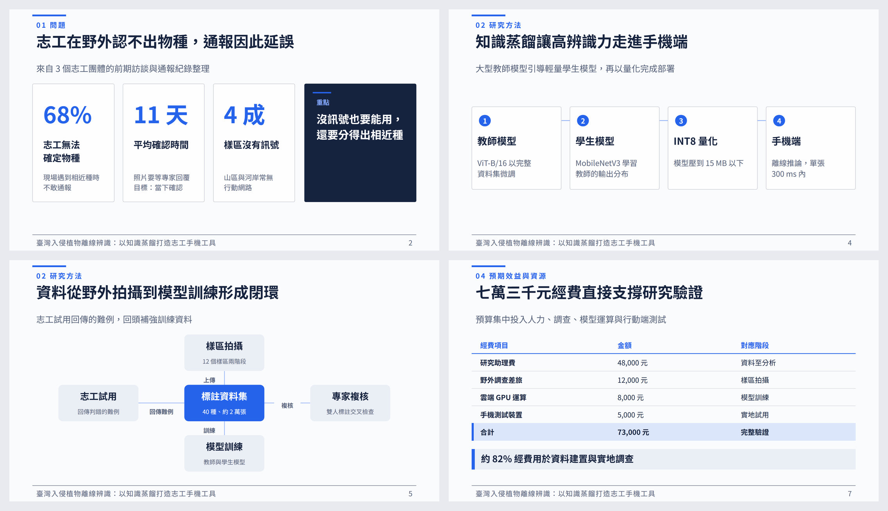

<picture>
  <source media="(prefers-color-scheme: dark)" srcset="odforge/brand/logo-dark.svg">
  
</picture>

# ODForge

Have your AI assistant make an editable slide deck, then fix it up together in the browser.

English | [繁體中文](README.md)

  



Ask Claude Code, Codex or a similar assistant for "a lecture deck on trees and binary trees", and it
uses ODForge to produce a native `.odp`: every word is an editable text box, not a screenshot. When
the deck is ready, an editor opens in your browser. Drag things around, edit text, and leave
comments where you want changes; the assistant applies them and you watch the page update.

It also makes text documents (`.odt`) and spreadsheets (`.ods`).

## Install

Install [uv](https://docs.astral.sh/uv/) first. [LibreOffice](https://www.libreoffice.org/) is
recommended too: ODForge runs it in the background to check layout and render previews. You never
have to open it.

**Claude Code**: type in the chat

```text
/plugin marketplace add FantasySakura0515/ODForge
/plugin install odforge@odforge
```

**Codex, Cursor or other assistants**: run in a terminal

```bash
uv tool install "odforge[web,cjk]"
odforge setup             # hook into Claude Code and Codex on this machine
```

To set up a single folder instead, or to hand the setup to others along with a project, run
`odforge init <folder>`. It writes `AGENTS.md`, `CLAUDE.md`, the skill and `.mcp.json` into the
folder, so any assistant opened there already knows how to use ODForge. An existing `AGENTS.md`
gets a section appended.

## Usage

Start a new conversation and describe the deck, for example:

> Make a 12-slide .odp introducing trees and binary trees to first-year students

Then:

1. The assistant asks a few questions (audience, occasion, length), outlines the deck and builds it.
2. When it is done, the editor opens in your browser.
3. Edit directly, or press 「留言」 (comment, shortcut C), click the object you want changed, write
   what you want, and press 「交給 AI 修改」 (hand to AI). The editor's labels are in Chinese.
4. The assistant applies the comments and deletes the ones it has handled. Repeat as often as you like.
5. Press 「完成」 (done) when you are happy.

Comments are stored inside the `.odp`, so they travel with the file.

## Web editor


Opens any `.odp`, not just ones ODForge made:

```bash
odforge edit deck.odp
```

- Drag to move; objects snap to neighbours and the slide centre, with distances shown. Hold ⌥ to
  disable snapping.
- Eight handles to resize, Shift keeps proportions; arrow keys nudge 0.5 mm, 5 mm with Shift.
- Double-click to edit text; fonts, sizes and bullets are preserved.
- Marquee selection, grouping, duplicate (⌘D), delete, undo and redo (⌘Z / ⇧⌘Z).
- The slide strip on the left reorders, duplicates, deletes and adds slides.

Every change is saved straight to the file, and anything the editor cannot draw (speaker notes,
unusual objects) is left untouched. If the assistant edits the same file, the page updates within a
second.

## Other ways to use it

### Generate directly, without an assistant

ODForge can call a language model itself. The file extension picks the document type:

```bash
odforge new "A 12-slide lesson on photosynthesis" -o photo.odp
odforge new "Lab report template: aim, method, results, discussion" -o report.odt
odforge new "Class grades, final = midterm 30% + exam 40% + coursework 30%" -o grades.ods
```

Choose the model with `--backend` or `ODFORGE_BACKEND`:

| Backend | Needs |
| --- | --- |
| `codex` (default) | [Codex CLI](https://github.com/openai/codex) installed and `codex login`; uses your ChatGPT account, no API key |
| `ollama` | [Ollama](https://ollama.com/) running locally; fully offline |
| `custom` | Any OpenAI-compatible API (DeepSeek, OpenAI, OpenRouter, vLLM…) via `ODFORGE_CUSTOM_BASE_URL`, `ODFORGE_CUSTOM_MODEL`, `ODFORGE_CUSTOM_API_KEY` |

Common deck options:

| Option | Meaning |
| --- | --- |
| `--theme` | Colours: `academic` `minimal` `dark` `teal` `forest` `navy` `violet` `crimson` `slate` `gold` `sky` `plum` `clay` |
| `--style` | Layout: `classic` `report` `academic` `keynote` `editorial` `passport` `zen` |
| `--mode` | `presenter` (few words, for speaking) or `detailed` (more text, for reading) |
| `--from-template FILE` | Reuse the colours and fonts of an existing `.otp` / `.odp` |
| `--image FILE`, `--logo FILE`, `--byline` | Add images, a logo, a cover byline |
| `--interactive` | Show the outline and wait for confirmation before filling slides |

Other settings (image generation, vision review, remote image allowlist) are in
[`odforge/.env.example`](odforge/.env.example).

### Check existing files

```bash
odforge check deck.odp              # format validation and overflow check, Markdown report
odforge check doc.docx -o diff.md   # convert to .odt, compare structure, check overflow
```

The overflow check lays the file out for real and reports text that spills out of its box, off the
slide or off the page, naming the slide and the text.

### Live preview

Let the assistant write the deck as JSON (`deck.json`); every save re-lays it out in the browser and
marks slides that overflow:

```bash
odforge preview deck.json
```

Useful while the overall structure is still changing. Once it settles, switch to the editor flow above.

### Web console

```bash
odforge serve        # http://127.0.0.1:8000
```

Type a request (PDFs and images can be attached); the model asks a few questions, lets you confirm
the outline, then builds the deck slide by slide. It binds to localhost only; `--allow-remote` is
required to expose it.

## Other MCP clients

ODForge is an MCP server: the assistant writes the content and ODForge lays it out, writes the file
and checks it, so no API key is needed. The install steps above configure it for you; for other
clients, add:

```json
{
  "mcpServers": {
    "odforge": {
      "command": "uvx",
      "args": ["--from", "odforge[web,cjk]", "odforge-mcp"]
    }
  }
}
```

| Tool | Purpose |
| --- | --- |
| `forge_presentation` / `forge_text_document` / `forge_spreadsheet` | Produce `.odp` / `.odt` / `.ods` |
| `inspect_odf` | Validate an existing file and check overflow |
| `preview_odf` | Render each page to an image so the assistant can look at it |
| `outline_odp` | List every object, position and text in an existing `.odp` |
| `edit_odp` | Edit an existing `.odp`: text, positions, slides, comments |
| `open_editor` | Open the web editor in the browser |
| `wait_for_feedback` | Wait for the user to hand comments to the AI and return them |

The server writes files wherever the assistant asks, so use it only with assistants you trust.

## How it works

The model never touches the file format. It writes structured content (the Document IR), which is
validated before a rendering engine writes the ODF, and the result then goes through several checks:

| Check | What | On failure |
| --- | --- | --- |
| Structure | zip layout, `mimetype`, manifest | Not delivered |
| XML | Every part well-formed | Not delivered |
| Conversion | Real conversion to PDF; spreadsheet formulas checked cell by cell | Reported, still delivered |
| Layout | A vision model reviews each page and fixes issues (optional) | Reported, still delivered |

Checks that did not run are reported as disabled or inconclusive, never as passed. Details in
[`odforge/docs/gates.md`](odforge/docs/gates.md).

These checks guarantee the file is correct and opens. **They do not guarantee the content is true.**
Numbers, dates, quotes and sources may be made up by the model; verify them yourself.

## Known limitations

- A new `.odt` table of contents is empty until the index is updated in a word processor.
- `.ods` has no native charts yet; images can only go into decks.
- `--from-template` reuses colours and fonts, not the template's layouts.

## Development

```bash
git clone https://github.com/FantasySakura0515/ODForge.git
cd ODForge/odforge
python3 -m venv .venv && source .venv/bin/activate
pip install -e ".[dev,web,cjk]"

pytest -q && ruff check .
npm --prefix web ci && npm --prefix web test
npm --prefix web run build      # odforge edit / serve need the built frontend
```

Pushing a `v*` tag publishes to PyPI once every test passes.

## License

MIT, see [odforge/LICENSE](odforge/LICENSE).
