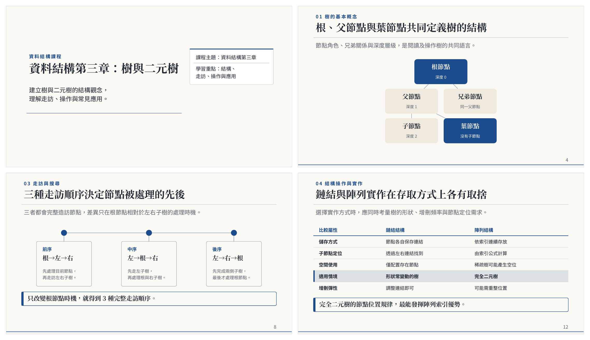

# ODForge（文鍛）

用一句話產生原生 ODF 文件：簡報 `.odp`、文書 `.odt`、試算表 `.ods`。

[English](README.en.md) | 繁體中文

  

```bash
odforge new "資料結構第三章：樹與二元樹的教學簡報" -o tree.odp
```



LLM 只負責寫內容，產出一份經過 schema 驗證的結構化 JSON（Document IR）；
XML 由渲染引擎寫，寫完再過驗證閘。模型從頭到尾不碰檔案格式，所以檔案結構
不會因為模型出錯而壞掉，投影片上的文字也都能直接編輯，不會是一張圖。

## 功能

- **三種文件**：簡報（19 種頁面版型，含圖表、流程、時間軸、指標、關係圖、表格、圖文）、
  文書（標題階層、目錄、表格、引言）、試算表（多工作表、原生公式）。
- **兩段式簡報**：先產大綱（美術方向與每頁骨架），確認後再逐頁填內容；可以在中間停下來改。
- **設計系統**：13 組配色主題、多種版式；中文字級與斷詞都有處理，簡報會把中文字型嵌進檔案，
  換一台沒裝字型的電腦開也不會走樣。
- **吃現有範本**：給一份 `.otp`／`.odp`／`.ott`／`.odt`，抽出配色與字型，新簡報沿用它的樣子。
- **素材**：插入自己的圖片、封面校徽；可接外部生圖服務。
- **四道品質閘**：zip 結構、XML、LibreOffice 實際轉檔、視覺模型逐頁審稿並自動修補。
- **跑版檢查**：用 LibreOffice 實際排版，找出超出框、超出右邊界或超出頁面的文字；
  自己產的檔和別人給的 `.odp`／`.odt`／`.docx` 都能查。
- **網頁編輯器**：`odforge edit deck.odp` 在瀏覽器裡直接拖動、縮放、改字、增刪和排序頁面，
  有對齊參考線和間距標示，每一步自動存回 `.odp`；不用打開 LibreOffice。
- **即時預覽**：讓你自己的 AI agent（Claude Code、Codex）寫內容，`odforge preview` 在瀏覽器即時顯示排版結果和跑版位置。
- **三種用法**：CLI、Web 控制台、MCP server（讓 Claude 等 AI 助理直接產檔，不需 API 金鑰）。

## 安裝

需要 Python 3.11 以上。建議裝 [LibreOffice](https://www.libreoffice.org/)：第三道閘、
預覽圖和視覺審稿都靠它，沒裝時其餘功能照常運作。

```bash
git clone https://github.com/FantasySakura0515/ODForge.git
cd ODForge/odforge
python3 -m venv .venv
source .venv/bin/activate          # Windows：.venv\Scripts\Activate.ps1
pip install -e ".[cjk,web]"
```

選用的 extras：

| extra | 用途 |
| --- | --- |
| `cjk` | 中文按詞斷行（jieba）。不裝也能跑，但會在任兩字之間斷行 |
| `web` | `odforge serve` 的 Web 控制台 |
| `vision` | 用 Claude 當視覺審稿後端 |

## 設定 LLM 後端

用 `--backend` 指定，或設環境變數 `ODFORGE_BACKEND`（預設 `codex`）。

| 後端 | 需要的設定 | 說明 |
| --- | --- | --- |
| `codex` | 本機裝好 [Codex CLI](https://github.com/openai/codex)（0.147.0 以上）並 `codex login` | 走自己的 ChatGPT 登入，不用 API 金鑰；只限本機使用。模型用 `ODFORGE_CODEX_MODEL` 指定 |
| `ollama` | 本機跑 [Ollama](https://ollama.com/)，預設模型 `qwen2.5` | 完全離線 |
| `custom` | `ODFORGE_CUSTOM_BASE_URL`、`ODFORGE_CUSTOM_MODEL`（`ODFORGE_CUSTOM_API_KEY` 選填） | 任何 OpenAI API 格式的服務：DeepSeek、OpenAI、OpenRouter、vLLM 等 |

例如用 DeepSeek：

```bash
export ODFORGE_BACKEND=custom
export ODFORGE_CUSTOM_BASE_URL=https://api.deepseek.com
export ODFORGE_CUSTOM_API_KEY=sk-...
export ODFORGE_CUSTOM_MODEL=deepseek-chat
```

每個後端都能對大綱、逐頁內容分別指定模型。完整變數清單（含生圖、視覺審稿、
遠端圖片白名單）見 [`odforge/.env.example`](odforge/.env.example)。

## 用法

### 產生文件

副檔名決定文件類型。

```bash
# 簡報
odforge new "介紹光合作用的教學簡報，12 頁" -o photo.odp

# 文書
odforge new "實驗報告模板：目的、方法、結果、討論" -o report.odt

# 試算表（公式在 LibreOffice 開啟時計算）
odforge new "全班成績表，學期成績 = 期中 30% + 期末 40% + 平時 30%" -o grades.ods
```

簡報常用選項：

| 選項 | 說明 |
| --- | --- |
| `--theme` | 配色：`academic` `minimal` `dark` `teal` `forest` `navy` `violet` `crimson` `slate` `gold` `sky` `plum` `clay`；省略時由模型挑 |
| `--style` | 版式，見下表；省略時用主題配對的預設版式 |
| `--mode` | `presenter`（講者型，字少）或 `detailed`（自讀型，字多） |
| `--language` | `zh-TW`（預設）、`en`、`bilingual` |
| `--interactive` | 大綱產完先印出來，確認後才繼續 |
| `--from-template FILE` | 沿用現有 ODF 範本的配色與字型 |
| `--image FILE` | 提供圖片素材，可重複指定 |
| `--byline`、`--logo FILE` | 封面署名、校徽；`--logo-placement` 決定校徽出現在哪幾頁 |
| `--qa` | 算圖後跑視覺審稿迴圈，需要 LibreOffice 和視覺後端 |
| `--one-shot` | 改用單次呼叫產生整份簡報，給較弱的本機模型用 |

版式決定構圖，配色只決定顏色和字體：

| 版式 | 依據 | 長相 |
| --- | --- | --- |
| `classic` | ODForge 原本的版面 | 置中封面、標題左側色條、滿版分節頁 |
| `report` | 顧問公司簡報結構 | 左上結論式標題、細線、頁尾出處與頁碼 |
| `academic` | Beamer metropolis 主題 | 標題下分隔線、底部進度條 |
| `keynote` | 舞台簡報 | 滿版強調色封面、內頁只有大字 |
| `editorial` | Swiss 平面風格 | 頂部通欄細線、超大淡色編號分節頁 |
| `passport` | 審查、提案、成果報告 | 白色框線卡片、右側深色重點面板，資訊密度最高 |
| `zen` | 極簡版面 | 沒有線也沒有頁尾 |

例如沿用學校的公版、加上校徽，並在產完後讓視覺模型審一輪：

```bash
export ODFORGE_VISION_BACKEND=claude ANTHROPIC_API_KEY=...
odforge new "期末專題進度報告" -o progress.odp \
  --from-template 校方公版.otp --logo logo.png --byline "資工三 王小明" --qa
```

視覺後端可選 `claude`、`ollama`、`codex`、`custom`，用 `ODFORGE_VISION_BACKEND` 設定。

### 檢查既有檔案

```bash
odforge check some.odp               # 驗證閘、樣式引用、跑版，輸出 Markdown 報告
odforge check some.docx -o diff.md   # 把 .docx 轉成 .odt，比對前後結構並檢查跑版
```

跑版檢查會讓 LibreOffice 把檔案排出來，再逐行比對文字落在哪裡：

- 簡報：文字超出所屬的框（會標出壓到哪段文字）或超出投影片。
- 文書：文字超出右邊界，或延伸到頁面外被裁掉（常見於太寬的表格）。

結果像這樣：

```text
## 跑版
- 發現 2 處跑版:
  - 第 15 頁「17輸出順序」文字超出框的下緣 1.96 cm
  - 第 15 頁「前序 (Pre)」文字超出框的下緣 1.01 cm
```

`odforge new` 產完也會自動跑一次。跑版只回報，不影響結束碼；沒裝 LibreOffice 時會註明略過，
不會顯示成通過。

### 比較模型

```bash
odforge benchmark "高中化學：酸鹼中和" --backend codex --backend ollama --pages 10
```

同一題交給多個後端，保留每個候選的大綱、IR、成品和預覽圖，並輸出結構品質比較報告。

## 網頁編輯器

```bash
odforge edit deck.odp            # 需要 web extra，並先建置前端（見 Web 控制台一節）
```

任何 `.odp` 都能開，不限 ODForge 產的。投影片直接畫成網頁元素，所見即所得：

- 拖曳移動，靠近其他物件或頁面中線時吸附，並顯示和左右上下鄰居的距離；按住 ⌥ 暫時不吸附。
- 拖卡片時，卡片裡的文字跟著走；拉八個把手縮放，Shift 等比例。
- 雙擊改字，Enter 換段、Shift+Enter 段內換行，原本的字型、字級、清單符號都保留。
- 方向鍵微調 0.5 mm，加 Shift 5 mm；框選多個物件；⌘D 複製、Delete 刪除、⌘Z / ⇧⌘Z 復原重做。
- 左側頁面列可拖曳排序、複製、刪除、新增頁；工具列可新增文字框和方塊。

每一步都直接存回檔案，用不到的部分（備忘稿、圖片、編輯器畫不出來的物件）原封不動。
檔案被別的程式改了（例如 AI 助理透過 MCP 的 `edit_odp`），開著的編輯器一秒內就會更新，
所以你和助理可以同時改同一份簡報。

## 即時預覽：讓你的 agent 寫，瀏覽器看

內容交給你已經在用的 AI agent（Claude Code、Codex 等），ODForge 只負責排版和檢查，
不需要另外設定任何 LLM 後端。

```bash
odforge preview deck.json        # 需要 web extra，並先建置前端（見下節）
```

`deck.json` 是一份簡報 IR。指令會開好瀏覽器；之後 agent 每次改這個檔存檔，預覽頁
幾秒內就重新排版、更新縮圖，標出跑版的頁面，並把 `.odp` 寫在 JSON 旁邊。終端機每
一版也會印一行摘要（第幾版、幾頁、哪裡跑版），在背景執行的 agent 讀它就知道要改哪裡。

[`odforge/skills/odforge-design`](odforge/skills/odforge-design/SKILL.md) 裡寫好了這套流程，
把它交給 agent 即可。

## Web 控制台

第一次使用前先建置前端（在 `odforge/` 目錄下；之後 `odforge serve` 會一併提供頁面）：

```bash
npm --prefix web ci
npm --prefix web run build
odforge serve        # http://127.0.0.1:8000
```

流程：

1. **輸入需求**，可附參考文件（PDF 會抽文字給模型讀；PNG/JPEG 當成可放進簡報的圖片）。
   頁數、場合、聽眾、語氣、語言、主題等欄位都能留白交給模型。
2. **需求訪談**：模型依需求的缺口追問，通常 3–5 題，整理成可編輯的需求摘要，確認後才開始。
3. **確認大綱**：可以直接改每一頁的骨架。
4. **逐頁生成**：畫面上看得到每一頁產出、預覽圖和四道閘的結果；不滿意的頁面可單頁重產。
5. **下載**。

範本庫可以自訂「版式 × 配色」（對比不足會當場擋下），也可以直接匯入學校或公司的
公版。工作紀錄與範本存在本機（預設在使用者的 application-data 目錄，可用
`ODFORGE_SESSIONS_DIR` 改位置），換瀏覽器或重新整理都還在。

服務沒有身分驗證，預設只綁 `127.0.0.1`；要對外綁定得加 `--allow-remote`，
而且 `codex` 後端在對外綁定時會拒絕執行。`serve` 會自動讀取 `odforge/.env`。

## MCP server

ODForge 也是一個 MCP server。這個模式下由 AI 助理自己寫 Document IR，
ODForge 只負責渲染與驗證，所以不需要任何 API 金鑰。

```json
{
  "mcpServers": {
    "odforge": {
      "command": "/path/to/ODForge/odforge/.venv/bin/odforge-mcp"
    }
  }
}
```

提供七個工具：

| 工具 | 用途 |
| --- | --- |
| `forge_presentation` | IR → `.odp` |
| `forge_text_document` | IR → `.odt` |
| `forge_spreadsheet` | IR → `.ods` |
| `inspect_odf` | 驗證既有的 ODF 檔，並檢查跑版 |
| `preview_odf` | 每頁轉成 PNG，讓助理看圖自查 |
| `outline_odp` | 列出既有 `.odp` 每頁的元素、位置與文字 |
| `edit_odp` | 原地修改既有 `.odp`：改字、搬位置、增刪頁，不動其他內容 |

文字放不下時，`forge_*` 照樣產出檔案，但回傳字串會附 `warning:`：一份是渲染前依版面預算
估算的超載，一份是 LibreOffice 實際排版後的跑版位置，讓助理縮短文字後重產。

[`odforge/skills/odforge-design`](odforge/skills/odforge-design/SKILL.md) 是給 Claude Code
等 agent 用的 skill，教它怎麼寫出好的簡報 IR、怎麼用 `preview_odf` 自查。

server 會把檔案寫到客戶端指定的任何路徑，請只搭配你信任的助理使用。

## 運作方式

```text
一句話
  │
  ▼
LLM ──► Document IR（pydantic 驗證的 JSON；壞掉的 JSON 先修復，修不好就擋下）
  │
  ▼
渲染引擎 ──► .odt / .ods 用 odfdo，.odp 手寫 XML
  │
  ▼
驗證閘 ──► 通過才交付
```

| 閘 | 檢查內容 | 沒過時 |
| --- | --- | --- |
| 1. 結構 | zip 結構、`mimetype` 位置、manifest | 不交付 |
| 2. XML | 每個部件 well-formed | 不交付 |
| 3. 轉檔 | LibreOffice headless 轉 PDF 成功；試算表逐張檢查公式錯誤 | 回報，照常交付 |
| 4. 設計 | 視覺模型逐頁看圖、找問題、修補後重算 | 回報，照常交付 |

第 3、4 道閘的結果一律照實回報為 `pass`、`fail`、未啟用或無法判定。沒跑的檢查
不會顯示成通過。完整定義見 [`odforge/docs/gates.md`](odforge/docs/gates.md)。

驗證閘只保證格式正確、打得開、版面有人（模型）看過，**不驗證內容真偽**。
數字、日期、引言與來源都可能是模型編的，請自行查證。

## 專案結構

```text
odforge/
├── src/odforge/
│   ├── ir.py            # Document IR，全系統的契約
│   ├── llm.py           # LLM 後端與兩段式生成
│   ├── render/          # odt.py / odp.py / ods.py
│   ├── themes.py        # 配色主題與版式
│   ├── textmetrics.py   # 文字量測與中文斷行
│   ├── fontembed.py     # 字型嵌入
│   ├── extract.py       # 從現有範本抽設計
│   ├── media.py         # 圖片素材與生圖介面
│   ├── package.py       # ODF zip 打包
│   ├── validate.py      # 驗證閘 1–3
│   ├── critic.py        # 驗證閘 4：視覺審稿迴圈
│   ├── preview.py       # 頁面轉 PNG
│   ├── check.py         # odforge check
│   ├── layoutcheck.py   # 跑版檢查
│   ├── benchmark.py     # odforge benchmark
│   ├── watch.py         # odforge preview：監看 IR 檔並即時更新
│   ├── scene.py         # 把 .odp 讀成網頁編輯器畫得出來的資料
│   ├── odpedit.py       # 編輯操作（移動、改字、頁面）與復原
│   ├── editor_api.py    # odforge edit 的後端
│   ├── webapi.py        # Web 控制台後端（FastAPI + SSE）
│   ├── mcp_server.py    # MCP 工具
│   └── cli.py
├── web/                 # Web 控制台前端（React + Vite）
├── skills/              # 給 agent 用的 skill
├── docs/                # gates、webapi、benchmark 說明
└── tests/
```

## 開發

```bash
cd odforge
pip install -e ".[dev]"

pytest -q
ruff check .

npm --prefix web ci
npm --prefix web test
npm --prefix web run typecheck
npm --prefix web run dev     # 前端開發伺服器，/api 轉給 odforge serve（:8000）
npm --prefix web run build
```

CI 跑兩條線：一條不釘版本（Ubuntu 與 Windows），提早發現上游套件變動；
一條用 `constraints.txt` 釘死版本，保證可重現。

## 已知限制

- `.odt` 的目錄剛產生時是空的，在 LibreOffice 裡右鍵「更新索引」就會填入。
- `.ods` 還沒有原生圖表。
- 圖片目前只能放進簡報。
- `--from-template` 只抽配色和字型，不沿用範本的母片版面。

## 授權

MIT，見 [odforge/LICENSE](odforge/LICENSE)。
